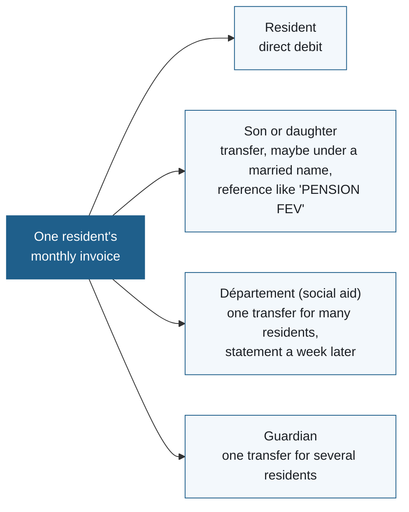
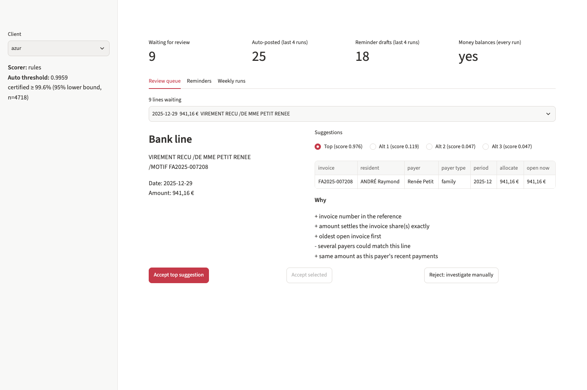
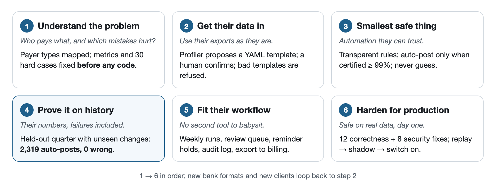
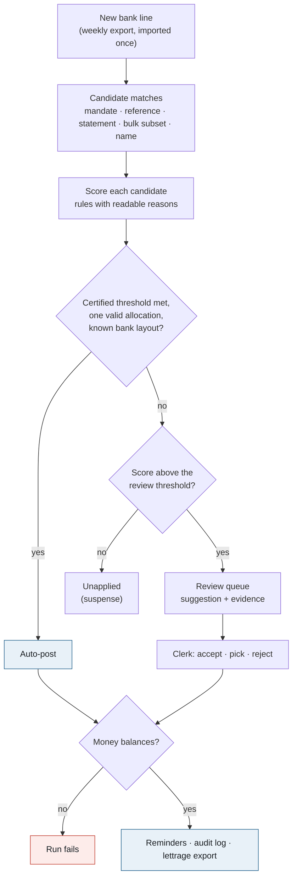
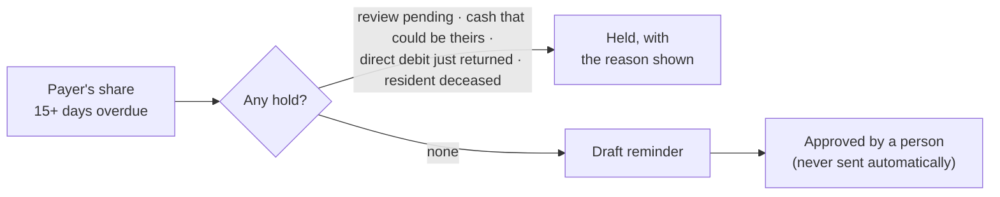
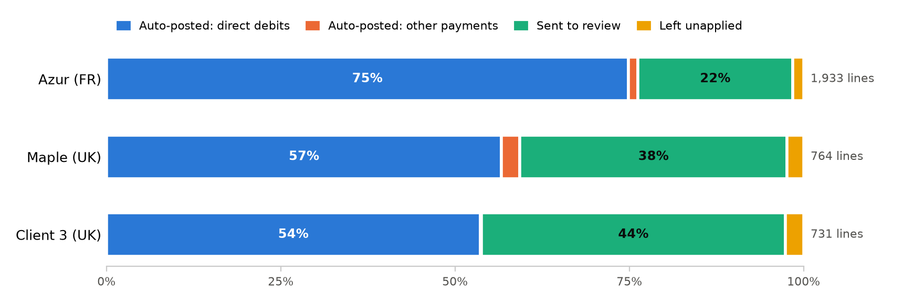
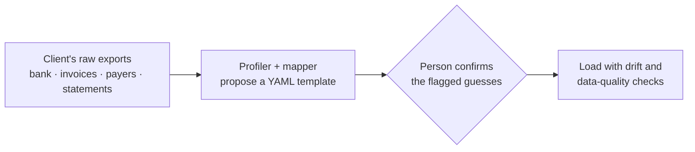
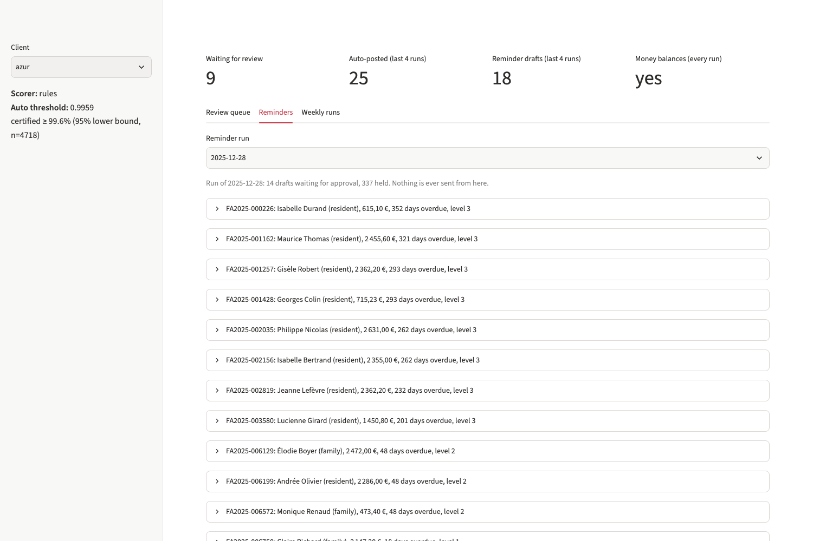

<div align="center">

# Reconcile

**Bank-to-invoice matching and safe payment reminders for care-home groups,<br>built the way a forward deployed engineer would ship it to a customer.**


[The FDE loop](#the-fde-loop-from-customer-problem-to-production) ·
[Results](#results) ·
[Try it](#try-it-in-two-minutes) ·
[Where it fails](#where-it-fails) ·
[Architecture](docs/architecture.md) ·
[Decisions](docs/decisions.md)

</div>

---

Every week, a French care home (EHPAD) receives hundreds of payments for its residents' invoices, and one invoice is rarely paid by one person:



A finance clerk matches each payment by hand. The expensive mistakes are posting money to the wrong family and chasing a family that has already paid.

**Reconcile** reads the care home's own bank and billing exports and works out which payment settles which invoice. It **posts only what it can prove**, queues everything else for a clerk with a suggested answer and the evidence, and **drafts reminders only when no unexplained money could belong to that family**.

> **Status:** a work sample, run on synthetic data with an exact answer key. It has not run on real books.

<p align="center"></p>

## At a glance

| **2,319**<br>bank lines auto-posted on a held-out quarter, **0 wrong** | **≥ 99.2%**<br>precision per client, 95% lower bound | **0**<br>overdue unpaid shares missed by reminders |
|:---:|:---:|:---:|
| **1–2**<br>reminders per client per quarter to a payer who had paid | **30 / 30**<br>hand-written hard cases, fixed before any code | **3 formats**<br>onboarded from YAML, zero Python changes |

**What those numbers mean:** most auto-posts are direct debits, 55.1–74.9% of the receivable lines in this simulation (an assumed mix). For family transfers, partial payments and bulk payments, the system auto-posts only 0.3–6.2% and sends the rest to a clerk, with the right answer as the first suggestion 59–69% of the time. The value is the safety around the automation, not the automation rate.

## The FDE loop: from customer problem to production

This project is organised the way I would run an engagement with a care-home group: understand their problem, get their data in, build the smallest safe thing, prove it on their own history, fit it into their workflow, and harden it for production.

<p align="center"></p>

| Stage | What the customer needs | What this repo does | Evidence |
|---|---|---|---|
| **1. Understand the problem** | Know who pays what, and which mistakes hurt | Models who pays an EHPAD invoice (resident's direct debit, family, département ASH in bulk, APA, guardians) and names the two costly errors. Metrics and 30 hard cases were committed **before any matching code** | [preregistration](docs/preregistration.md), [hard cases](eval/hard_cases.yaml), [glossary](docs/glossary.md) |
| **2. Get their data in** | Use their exports as they are, not a format we invent | A profiler and mapper propose a YAML template from raw files; a human confirms it. Drift and data-quality checks refuse a wrong template loudly | `make onboard`, [mapping eval](reports/mapping_eval.md) |
| **3. Build the smallest safe thing** | Automation they can trust, with reasons a clerk can check | Candidate matches, scored by transparent rules. Auto-post only above a threshold certified at ≥ 99% precision (Clopper–Pearson lower bound). Ambiguous payments are never guessed | [decisions](docs/decisions.md#matching), `pipeline explain` |
| **4. Prove it on their history** | Numbers on their books, failures included | Certify on 9 months, then test on a quarter with changes never seen before: a new bank label format, married names, a new statement layout. Every failure is traced to its cause | [eval reports](reports/eval_azur_rules.md), [where it fails](#where-it-fails) |
| **5. Fit their workflow** | No second tool to babysit | Weekly runs safe to repeat, a review queue app, reminder drafts with safety holds, an audit log, and a lettrage export back to the billing software. The run fails if the money does not balance | `make app`, `make run`, `make export` |
| **6. Harden for production** | Safe on real data, on day one | Four independent reviews found 12 correctness bugs and 8 security issues, all fixed and tested. A week-by-week plan for a real client: replay, shadow, switch on what certifies | [review log](docs/review-log.md), [first weeks](docs/first-weeks.md) |

## How a payment is decided

Every bank line goes through the same path, every week. Nothing is posted on a hunch: a line is auto-posted only when the evidence clears a threshold certified on the client's own history.



A reminder goes out only after every hold has been checked, and a person approves it:



## Results

Rules scorer, test months 10–12, 14 weekly runs. Every number is in `reports/eval_<client>_rules.md`.

<p align="center"></p>

| | Azur (FR, 600 residents) | Maple (UK, 300) | Client 3 (UK, scrambled schema) |
|---|---:|---:|---:|
| Auto-posted lines (wrong) | 1473 (0) | 453 (0) | 393 (0) |
| Precision, 95% lower bound | 99.8% | 99.3% | 99.2% |
| Automation, all receivable lines | 76.2% | 59.3% | 53.8% |
| Automation, excluding direct debits | 5.3% | 6.2% | 0.3% |
| Review queue: first suggestion right | 69.1% | 59.0% | 63.6% |
| Review lines per week | 30.7 | 20.9 | 22.9 |
| Left unapplied (suspense) | 30 | 18 | 19 |
| Reminder drafts / for a share already paid | 255 / 1 | 151 / 2 | 136 / 2 |
| Overdue unpaid shares never drafted or held | 0 | 0 | 0 |
| Money balanced after every weekly run | ✅ | ✅ | ✅ |

**A learned model** (gradient boosting) is compared in [decisions](docs/decisions.md#model-vs-rules):
- **On Azur** it certifies, and its first suggestion in review is right 90.8% of the time against 69.1% for rules.
- **On the two smaller clients** it falls just short of certifying (98.99% and 98.98% against 99%), so it posts nothing.

Rules therefore ship first, and the model is switched on per client.

<details>
<summary><b>What it does with each kind of payment</b> (30 hand-written cases, 30/30 pass)</summary>

<br>

These cases use fixed thresholds (auto ≥ 0.95), so they do not depend on one dataset. Under Azur's certified threshold of 0.996, the rows marked auto at 0.98 would go to review. Full table: [reports/hard_cases.md](reports/hard_cases.md).

| Situation | Outcome |
|---|---|
| Direct debit returned unpaid (`REJET PRLV`) | posted automatically, invoice re-opened |
| Daughter pays under her married name, from an unknown account | review, correct invoice suggested first |
| Same daughter next month, after a clerk confirmed her once | auto (the alias was learned) |
| Partial payment, €600 of €2,400 | review: never automatic |
| Département transfer whose statement arrives a week later | auto (0.98), via the payer's open shares for the period |
| Guardian payment that several combinations of invoices fit | review: "several combinations fit (never auto)" |
| APA lump sum from the département | recognised as not a receivable |
| Reminder due, but unexplained cash from the family arrived last week | reminder held |

On the real test quarter, married names are much harder than this case: the right answer is first for only 1 of 7 on Azur.

</details>

## Try it in two minutes

You need [uv](https://docs.astral.sh/uv/). No API key is needed.

```bash
make all     # generate 3 clients, run the evaluation, write reports/ (about 2 minutes)
make app     # review queue and reminder approval at http://localhost:8501
```

Ask why any bank line was posted, queued or left open:

```console
$ uv run python -m reconcile.pipeline explain --client azur --line b3c146d4
bank line b3c146d4312128e5  2025-12-29  941.16
  label:     VIREMENT RECU /DE MME PETIT RENEE
  reference: /MOTIF FA2025-007208
outcome: review
thresholds: auto >= 0.9959, review >= 0.7311
top: reference  score 0.9759
    FA2025-007208  Renée Petit (family)  941.16
    + invoice number in the reference
    + amount settles the invoice share(s) exactly
    + oldest open invoice first
    - several payers could match this line
    + same amount as this payer's recent payments
```

The evidence is strong, but several payers named Petit have open invoices, so the score sits just under the certified threshold and a clerk confirms it with one click. `make export CLIENT=azur` writes the lettrage CSV the billing software would receive.

<details>
<summary><b>All commands</b></summary>

```bash
make all           # data + rules evaluation + mapping eval + hard cases
make experiments   # learned model on 3 clients, noise sweep, cold-start feedback loop
make onboard CLIENT=client3            # propose a template from raw exports, confirm, save
make eval CLIENT=client3               # history -> thresholds -> 14 weekly runs -> report
make run CLIENT=azur WEEK=2025-12-31   # one weekly run on saved state; rerunning imports nothing new
make export CLIENT=azur                # lettrage CSV for the billing software
make test                              # 75 tests
make lint                              # ruff + ty
```

</details>

## Onboarding a new client



Client 3 has different headers, a signed amount instead of debit/credit columns, other category codes and a junk column. `make onboard` proposes a template and flags what it inferred from the data rather than from headers, for a human to confirm:

```text
billing_export.csv   doc_type value     ADJ  -> credit  conf=0.50  <-- inferred from data, please check
funding_sources.csv  payer_type value   TPT  -> family  conf=0.50  <-- inferred from data, please check
```

No Python file contains a client's header (a test enforces it).

**On export formats it has never seen** ([mapping eval](reports/mapping_eval.md)):
- **The 3 clients:** mapped 100% correctly.
- **12 extra schemas** whose headers come from a vocabulary the mapper does not know: none onboards correctly unattended, and 388/551 mapping decisions are right (70.4%).
- **What the checks catch:** 11 of the 12 are refused loudly, so the mistake surfaces at onboarding, not in the books.
- **The failure that matters:** 1 schema loads while wrong.

## Where it fails

1. **The bank's new label format.** In the test quarter, Azur's bank changes how transfers are labelled. Lines in the new format (420 of 1,933) are never auto-posted, and the right answer is first for only 67.9% of them, against 99.7% for unchanged lines. A guard holds them until reviewed lines of the new layout certify ≥ 99%; a looser guard I tried released a slice that was 91% right. The fix that is not built: an alert on a new layout, so someone updates the label parser in week one.
2. **Wrong reminders: 1 / 2 / 2.** All five come from the held-out changes: a married name from a new account, or a typo in the new format. Each is listed in the eval reports with the bank line that had paid it.
3. **The holds have a price.** About 330 reminders per client per quarter were delayed for shares that really were unpaid: the cost of chasing almost no one who already paid.
4. **Messier data costs review effort, not precision.** With every messiness rate multiplied by 0.5× to 3×:
   - precision stays at 100% (99.8% bound);
   - the first suggestion in review falls from 87.1% to 60.7% right ([noise sweep](reports/noise_sweep_azur_rules.png)).
5. **Learning from the review queue alone did not work.** From a cold start, a model retrained on review labels never certified; a client's own historical lettering is the real training signal ([feedback loop](reports/feedback_azur.png)).

## Why the numbers can be trusted

- **Truth by construction.** The generator simulates who meant to pay what, then renders it in each client's export formats. The answer key never reaches the pipeline.
- **Fixed before the code.** Metrics and hard cases are unchanged since the first commit (`1912ff0`). Four deviations are declared in [preregistration](docs/preregistration.md).
- **A bound, not a point estimate.** Thresholds are certified on history; when nothing certifies, nothing is posted.
- **Reproducible.** `make all` regenerates the data and rules results byte for byte; `make experiments` adds the rest.

## Where the LLM is used, and where it is not

- **Used:** only at onboarding, to propose a mapping template from column profiles.
  - Words that could be names are masked first, and a test checks that no resident or family name is sent.
  - Proposals are validated against the real files, columns and allowed values.
  - A human confirms the final template, with each disagreement flagged.
- **Not used:** anywhere in the weekly payment path, which has to be deterministic, cheap and explainable.
- **Not yet measured:** no API key was available while building, so every result above comes from the deterministic mapper.

## Limitations

- **Synthetic data.** I wrote both the generator and the matcher, so circularity is the main risk. It is mitigated by held-out changes, a noise sweep, hard cases written first, and a rules baseline. None of it replaces a week on real books.
- **Simplifications** are listed in [decisions](docs/decisions.md#domain). For example, direct debits arrive as one line per resident.
- **The review app** is a single-operator tool on localhost, with no login. Open items are in the [review log](docs/review-log.md#not-fixed).

## Repository guide

| Document | What it covers |
|---|---|
| [Architecture](docs/architecture.md) | Code map, data flow, where each invariant is enforced and tested |
| [Decisions](docs/decisions.md) | Every design decision, the alternative, and why; model vs rules |
| [Review log](docs/review-log.md) | What the correctness, security, quality and docs reviews found, and what was fixed |
| [First weeks](docs/first-weeks.md) | How I would run this with a real client: replay, shadow, switch on |
| [Glossary](docs/glossary.md) | Lettrage, ASH, APA, RUM, UDAF, and the project's own terms |
| [Preregistration](docs/preregistration.md) | Metrics and risks as written before the matching code |

<p align="center"></p>

## About

Built by **Amith Reddy** as a work sample for a forward deployed engineering role.
[amithkm9@gmail.com](mailto:amithkm9@gmail.com) · [LinkedIn](https://www.linkedin.com/in/amithreddy10/) · [GitHub](https://github.com/amithkm9)

I used an AI coding assistant for most of the code. I specified the problem, the metrics and the hard cases before any matching code, made the design decisions in [decisions](docs/decisions.md), and checked every number against the reports. I then had the repository independently reviewed for correctness, security and quality, and fixed what was found ([review log](docs/review-log.md)).
