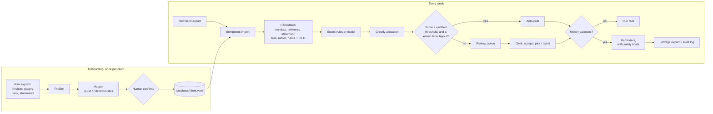

# Reconcile

Bank-to-invoice matching ("lettrage") and safe dunning for care-home groups: French EHPAD and UK care homes. A new client is onboarded from their raw exports with a YAML template, not code.

**Result.** On three synthetic clients' held-out test quarters, every bank line the system posted on its own was posted correctly. That is 2,320 auto-posts, 0 wrong, with a 95% lower bound of 99.2–99.8% per client. It automated 54–76% of lines (rules scorer) and put the rest in a review queue with the right answer on top 81–92% of the time. Reminders went out for an already-paid invoice 1–2 times per client per quarter. All three clients ran on the same code; the only per-client artefact is a machine-proposed template.

Everything here runs on synthetic data with exact ground truth. Nothing has touched a real client's books. See [what that does and doesn't prove](#limitations).

## The problem

An EHPAD invoices each resident monthly, but the money arrives from many places:
- the resident's direct debit;
- a daughter's bank transfer under her married name, with "PENSION FEV" as the only reference;
- a département paying aid for 40 residents in one transfer, with a statement that arrives a week later;
- a guardian association paying for several residents at once.

A finance clerk matches each bank line to invoice shares by hand, every week. The expensive mistake is not a slow match. It is posting a payment to the wrong family, or sending a reminder to a family that has already paid.

So the design goal is **never post a wrong match on its own, and never chase a paid invoice**. Automation is whatever is left after that constraint.

## Results (test months 10–12, decided week by week)

Every number below is copied from `reports/eval_<client>_<scorer>.md` and `reports/metrics_*.json`.

| | Azur (FR, 600 residents) | | Maple (UK, 300) | | Client 3 (UK, perturbed schema) | |
|---|---|---|---|---|---|---|
| | **rules** | model | **rules** | model | **rules** | model |
| Auto-posts / wrong | 1473 / 0 | 1500 / 0 | 453 / 0 | 465 / 0 | 394 / 0 | 426 / 0 |
| Auto precision, 95% lower bound | 99.8% | 99.8% | 99.3% | 99.4% | 99.2% | 99.3% |
| Automation (lines / amount) | 76.2% / 69.0% | 77.6% / 76.5% | 59.3% / 63.7% | 60.9% / 71.2% | 53.9% / 44.9% | 58.3% / 68.7% |
| Review: top suggestion right | 91.6% | 95.6% | 80.8% | 78.4% | 81.0% | 74.4% |
| Review lines per week | 30.7 | 27.4 | 20.1 | 16.1 | 22.6 | 15.9 |
| Wrong reminders (invoice already paid) | 1 | 0 | 2 | 2 | 2 | 11 |
| Reminder drafts | 253 | 170 | 113 | 24 | 112 | 18 |
| Money balances after every weekly run | yes | yes | yes | yes | yes | yes |

**How to read the table:**
- **Precision** is per bank line, and the whole allocation must be exact. A 40-invoice transfer with 39 invoices right counts as wrong.
- **The auto threshold** is the lowest score whose Clopper–Pearson 95% lower bound is ≥ 99%. It is chosen on months 1–9 only. When nothing can be certified, nothing is auto-posted.
- **Test months** contain corruptions that never appear earlier:
  - the bank changes its transfer label format;
  - family members pay under married names from new accounts;
  - a département changes its statement layout.

**Rules ship by default.** The learned model (gradient boosting, trained on months 1–7, threshold from a months 8–9 shadow run) automates a little more on every client. Two things count against it:
- It writes far fewer reminder drafts: 24 vs 113 on Maple. Part of its "fewer wrong reminders" is simply sending fewer reminders.
- On Client 3 it produced 11 wrong reminders against 2.

Rules also explain themselves in words a clerk can check ("invoice number in the reference"). The model is the upgrade per client, once its shadow run certifies and beats rules on review effort. More in [docs/decisions.md](docs/decisions.md#model-vs-rules).

### Hard cases

There are 30 hand-written situations, written before the matching code, run through the real weekly pipeline. **30/30 pass** (`reports/hard_cases.md`). A selection:

| Situation | What it did | Score |
|---|---|---|
| Direct debit returned unpaid (`REJET PRLV`) | auto: re-opens the invoice | 1.000 |
| Daughter pays under her married name, from an unknown account | review, correct invoice on top | 0.881 |
| Same daughter next month, after a reviewer confirmed the alias once | auto | 0.999 |
| Partial payment, €600 of €2,400 | review (never auto for a partial) | 0.622 |
| ASH bulk transfer whose statement arrives a week late | auto, via the payer's open shares for the period | 0.982 |
| Guardian bulk payment that several invoice combinations fit | review: "several combinations fit (never auto)" | 0.378 |
| APA lump sum from the département | not a receivable (`non_ar`) | — |
| Reminder due, but unexplained cash from the family arrived last week | reminder held (`unapplied_cash`) | — |

## How it works



**One scorer for every match type.** Each candidate is a set of edges to invoice shares plus signals, so a direct debit, a partial payment and a 40-line département transfer are ranked on the same scale. Thresholds apply after allocation, to what would actually be posted.

**Safety mechanisms, each one measured:**
- **Certified threshold.** Explained under the results table.
- **Ambiguity.** If more than one invoice combination fits a bulk amount, the line never auto-posts.
- **New-format guard.** A bank label layout never seen in history cannot auto-post. It is released only when the reviewed lines it held back certify ≥ 99% by the same lower-bound rule. Without it, the model on Azur posted the bank's new format at 90.2% precision (an earlier run, recorded in [decisions](docs/decisions.md#safety)).
- **Reminder holds.** A reminder is held for:
  - a pending review touching the invoice;
  - unexplained cash in the last 90 days that could be the resident's;
  - a just-returned direct debit;
  - a deceased resident.
- **Money balance.** After every run, credits = allocated + suspense + non-receivable income, and no line or invoice share is over-allocated. Otherwise the run fails. This check caught three real bugs during the build.

## Onboarding a new client in 3 commands

```bash
make data                                   # synthetic exports for 3 clients (+ 12 schema variants)
make onboard CLIENT=client3                 # profile the exports, propose a template, ask to confirm
make eval CLIENT=client3                    # history -> thresholds -> 14 weekly test runs -> report
```

Client 3 has different headers from Maple, a signed amount column instead of debit/credit, other category codes, and a junk column. The proposal took 2.2 s in the run I recorded, and it flagged the two inferences it made from data rather than headers:

```
billing_export.csv   doc_type value     ADJ  -> credit  conf=0.50  <-- inferred from data, please check
funding_sources.csv  payer_type value   TPT  -> family  conf=0.50  <-- inferred from data, please check
```

No Python file mentions a client header (a test enforces this), and the committed templates are exactly what `onboard` proposes.

**Mapping eval** (`reports/mapping_eval.md`): 15 schemas, the 3 clients plus 12 variants whose headers come from a vocabulary pool disjoint from the mapper's.
- **The 3 clients:** 100% correct.
- **The 12 variants:** 388/551 decisions right (70.4%).
- **Variants refused:** 11 of the 12, by the drift checks or the data-quality gates, so the mistake surfaces at onboarding rather than in the books.
- **The failure that matters:** 1 variant (`variant_11_maple`, 84.4% right) loads while silently wrong.

## Where the LLM is used, and where it isn't

- **Used:** only at onboarding, to propose a template from column *profiles*. Person names are masked as `<A>`, and the model never sees rows, because this is health-adjacent data.
  - One wrapper (`reconcile/llm.py`) does structured output (`messages.parse` with a pydantic schema), a record/replay cache, and per-call logging of tokens, latency and cost.
  - Any failure falls back to the deterministic mapper.
- **Not used:** in the weekly path. Matching thousands of lines a week has to be deterministic, cheap and explainable. Reminders are template text, not generated.
- **Not yet measured:** no API key was available while building. The Sonnet/Haiku rows of the mapping eval therefore say "not run", and every result in this README comes from the deterministic mapper. One run with a key fills the replay cache; after that the eval is free and reproducible.

## Failure analysis

**1. The bank's new label format is never auto-posted in the test quarter.**
- **Scale:** 420 of 1,933 Azur test lines (257 Maple, 266 Client 3) go to review.
- **Lower-precision suggestions:** the top suggestion on those lines is right only 67.9% / 56.0% / 60.5% of the time (rules), against 99.7% on unshifted Azur lines.
- **What it costs:** most of the review queue. Rules held back 77 Azur auto-posts.
- **How the release rule was chosen:** I tried a looser release rule (30 held-back lines at ≥ 97% accepted). It lifted the guard and released a slice that was really 91–95% right: 18 wrong auto-posts for the model on Azur. That run was superseded; it is recorded in [decisions](docs/decisions.md#safety).
- **The real fix is not built:** alert on a new layout and update the label parser in week one.

**2. Wrong reminders: 1 / 2 / 2 (rules), all caused by held-out shifts.**
- **Azur:** a catch-up payment for two months, in the new label format, by a family member under a married name from a new account, with an empty reference (`VIREMENT RECU /DE MME FRANCOIS HELENE`, `/MOTIF`).
- **Maple:** both are one payment, `FP D THOAMS`: an initial, a typo, the new format, and two old invoices paid at once.
- **Client 3:** both are married-name payments (`FP S PARKER EDWARD`, `FP MRS E CLARK INV`).

**3. The holds cost something.**
- **Delayed reminders:** a hold delayed reminders for genuinely unpaid invoices 329 / 295 / 289 times per quarter. That is the price of 1–2 wrong reminders instead of many more.
- **Missed reminders:** Maple has 4 and Client 3 has 2 (overdue, unpaid, and neither drafted nor held). I have not diagnosed these yet.

**4. Messier data degrades recall, not precision.**
- **Noise sweep** (`reports/noise_sweep_azur_rules.md`): every messiness rate multiplied from 0.5× to 3×.
- **Precision:** stays at 100%, with a 99.8% lower bound.
- **Top-suggestion accuracy:** falls from 96.6% to 89.1%.
- **Wrong reminders:** rise from 0 to 4.

**5. Learning from the review queue alone did not work.**
- **The setup:** a cold start with no history, a simulated reviewer making 3% errors, and retraining every 4 weeks.
- **What it achieved:** the rules scorer held 70–77% automation at 100% precision every month (`reports/feedback_azur.md`).
- **The retrained model:** never certified 99%. Review labels over-represent the hard cases. The real training signal is the client's historical lettrage, which is what the model above uses.

**6. Greedy allocation is not optimal, and that is measured.** On small conflict components, greedy found a worse total than exhaustive search in 1 of 188 (Azur), 0 of 138 (Maple) and 3 of 138 (Client 3).

## What I'd ask the customer in week 1

1. **A year of lettered history and the matching bank exports.** This sets the auto threshold and trains the model. Without it, we start on rules and certify on live review.
2. **Your current error tolerance.** How many misposts per month does the team catch today, and what does one cost to unwind? That sets the 99% target, which is a parameter.
3. **The payment-method mix.** What share pays by direct debit, by family transfer, or through the département or a guardian? No public source gives this, so the synthetic mix is an assumption (`config/*.yaml`).
4. **The ASH/APA statements.** Do they arrive as PDF, CSV or paper, and how late? Statements are the primary path for bulk payments.
5. **Who approves reminders,** and which cases are never chased: deceased residents, or disputes in progress.
6. **The billing software and its import format,** to replace the generic lettrage CSV export.
7. **Hosting constraints.** Is HDS-certified hosting required? Can column profiles (never rows) be sent to an LLM at all?

## Limitations

- **Synthetic data, so circularity is the main risk.** I wrote both the generator and the matcher. The mitigations:
  - the test quarter contains corruption types never seen in training;
  - the noise sweep;
  - the hard cases were written before the matcher;
  - the rules baseline is always reported next to the model.

  None of this replaces a week on a real client's books.
- **Simplifications** are listed in [docs/decisions.md](docs/decisions.md#domain). Examples:
  - direct debits arrive as one line per resident, not as a batch;
  - local authorities pay monthly;
  - credit notes arrive with their invoice.
- **The LLM mapping path is untested** (see above).
- **The review app** (`make app`) has been driven headless with Streamlit's test harness: the queue rendered, and an Accept wrote a label, an audit row and the saved state. It has not been used by a clerk.

**Next steps:**
1. Run the LLM mapping eval with a key.
2. Add a new-layout alert, plus a parser update path.
3. Diagnose the 6 missed reminders.
4. Add batch SEPA DD files.
5. Add a PDF statement reader.

## Quickstart

Requires [uv](https://docs.astral.sh/uv/). No API key is needed.

```bash
make all          # data + rules eval for 3 clients + mapping eval + hard cases (~1-2 min)
make test         # 62 tests
make experiments  # learned model on 3 clients, noise sweep, feedback loop (slower)
make app          # review queue + reminder approval on the saved state (Streamlit)
make run CLIENT=azur WEEK=2025-12-31   # one weekly run on saved state; re-running imports nothing new
make export CLIENT=azur                # lettrage CSV for the billing software
```

**Reports:**
- `reports/eval_*.md`: per-client results, by match type, by shift, and every auto error.
- `reports/hard_cases.md`
- `reports/mapping_eval.md`
- Plots:
  - [noise sweep](reports/noise_sweep_azur_rules.png)
  - [feedback loop](reports/feedback_azur.png)
  - reliability diagrams ([Azur](reports/reliability_azur.png), [Maple](reports/reliability_maple.png), [Client 3](reports/reliability_client3.png)), Brier 0.0245 / 0.0126 / 0.0186

The probability shown to reviewers is calibrated for display only. Calibration never changes what is auto-posted.

**Design decisions and the reasons behind them:** [docs/decisions.md](docs/decisions.md).
