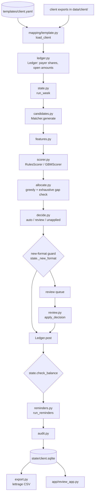

# Architecture

About 7,000 lines of Python. The weekly pipeline is deterministic: no model call sits on the path from a bank line to a posting.

## Where to start reading

1. `reconcile/state.py` → `run_week`: one weekly run, end to end. Everything else is called from here.
2. `reconcile/candidates.py` → `Matcher.generate`: what could this bank line be paying?
3. `reconcile/scorer.py` → `RULES`: how much evidence each candidate has, in words a clerk can check.
4. `reconcile/decide.py` → `choose_thresholds`: how the auto-post threshold is certified.
5. `reconcile/reminders.py` → `_hold`: why a reminder is or is not drafted.

## Flow of one weekly run

## Module map

| Module | Responsibility | Entry point |
|---|---|---|
| **Onboarding** | | |
| `mapping/profile.py` | Dialect, header and footer rows, and per-column type of an unknown export. Masks names before anything can reach an LLM | `profile_file`, `mask_value` |
| `mapping/propose_fallback.py` | Deterministic mapper: header similarity × value-type compatibility, then optimal assignment (Hungarian) | `propose` |
| `mapping/propose_llm.py` | Optional LLM mapper. Its output is validated against discovered files, real columns and allowed values | `propose`, `_merge` |
| `mapping/onboard.py` | CLI: propose, show for confirmation, test-load, save the template | `onboard` |
| `mapping/template.py` | Load exports through a template; drift checks and data-quality gates | `load_client` |
| `entities.py` | The common entity model (pydantic) that every client is mapped into | `validate_frame` |
| **Matching** | | |
| `normalize.py`, `ids.py` | Text, names, references; content hash of a bank line (idempotent import) | `norm_name`, `bank_line_hash` |
| `alloc_rules.py` | Lettrage conventions shared with the generator: share split, oldest-first, €2 tolerance | `fifo_allocate` |
| `ledger.py` | Payer shares of each invoice and what has been allocated to them | `Ledger.post`, `Ledger.record` |
| `candidates.py` | Five ways a line can match: DD return, mandate or reference, remittance statement, bulk subset, name + FIFO | `Matcher.generate` |
| `features.py` | Point-in-time features for one candidate | `candidate_features` |
| `scorer.py` | Rules scorer (named evidence) and gradient boosting, same interface | `Scorer` |
| `allocate.py` | At most one allocation per line; greedy, with its gap to exhaustive search measured | `greedy`, `exhaustive_gap` |
| `decide.py` | Clopper–Pearson certified threshold; outcome per line | `choose_thresholds`, `outcome` |
| **Weekly operation** | | |
| `state.py` | `run_week`, the new-format guard, the money balance check, sqlite persistence | `run_week`, `check_balance` |
| `reminders.py` | One draft per overdue payer share, unless a hold applies | `run_reminders` |
| `review.py` | The single write path for human (and simulated) review decisions | `apply_decision` |
| `audit.py` | Append-only JSONL of every post, decision and reminder action | `AuditLog` |
| `export.py` | Lettrage CSV for the billing software | `export_lettrage` |
| `pipeline.py` | CLI: `eval`, `run`, `export`, `explain` | `main` |
| `app/review_app.py` | Streamlit review queue and reminder approval (localhost only) | `make app` |
| **Evaluation** | | |
| `generate/` | Synthetic care-home groups with exact ground truth in `data/<client>/_truth/` | `generate_client` |
| `evaluate.py` | History → thresholds → 14 weekly test runs → metrics and report | `evaluate_client` |
| `hardcases.py` | The 30 hand-written cases through the real pipeline | `write_report` |
| `experiments.py` | Mapping eval, noise sweep, cold-start feedback loop | `main` |
| `llm.py` | The only door to a language model: structured output, replay cache, call log | `structured_call` |
| `paths.py`, `plots.py`, `dates.py` | Client paths (validated), charts, calendar helpers | |

## Files in and out

| Path | What | In git |
|---|---|---|
| `config/<client>.yaml` | Generator settings for a synthetic client (volumes, payment mix, messiness rates) | yes |
| `templates/<client>.yaml` | The mapping template: the only per-client input to the pipeline | yes |
| `data/<client>/` | The client's exports (synthetic) | no (`make data`) |
| `data/<client>/_truth/` | The answer key. Read by `evaluate.py` only, never by the pipeline | no |
| `state/<client>.sqlite` | Ledger, decisions, labels, reminders, runs; the model file sits next to it, with its hash in `meta` | no |
| `reports/` | Eval reports, metrics JSON, plots, sample lettrage export | yes (synthetic only) |
| `reports/audit_<client>.jsonl` | Audit log | no |
| `llm_cache/` | Recorded LLM responses for replay (created on the first run with a key) | no |

## Invariants, and where each is enforced

| Invariant | Enforced by | Tested by |
|---|---|---|
| Credits = allocated + suspense + non-receivable income; no line or share over-allocated | `state.check_balance`, run fails otherwise | `test_money_balances_after_every_run`, `test_balance_check_catches_an_over_allocated_line` |
| A posting never exceeds the bank line | `Ledger.post`, `candidates._within_line` | `test_remittance_never_allocates_more_than_the_line` |
| Re-importing a file imports nothing; identical twins inside one file are both kept | `ids.bank_line_hash` with an occurrence index | `test_overlapping_exports_import_once`, `test_identical_lines_inside_one_export_are_both_kept` |
| Auto posts are final; review actions post once | `run_week`, `apply_decision` | `test_auto_posts_are_final`, `test_review_actions_post_once_and_refuse_conflicts` |
| Saved state reloads identically | `Ledger.record` shared by post and load | `test_saved_state_reloads_identically` |
| Features never see the future | `features.candidate_features` reads only prior state | `test_features_are_point_in_time` |
| No client header in Python; onboarding changes no `.py` file | YAML templates and synonyms only | `test_no_client_header_is_hard_coded_in_python`, `test_new_client_onboards_without_code_change` |
| No person name reaches the LLM | `profile.mask_value` | `test_llm_profiles_carry_no_person_names` |
| A new bank layout is not auto-posted until certified | `state._new_format` | `test_new_layout_needs_certified_probation` |
| A model file is unpickled only if its hash matches the saved state | `GBMScorer.load` | `test_model_file_is_only_unpickled_when_its_hash_matches` |
